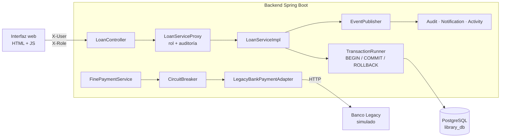
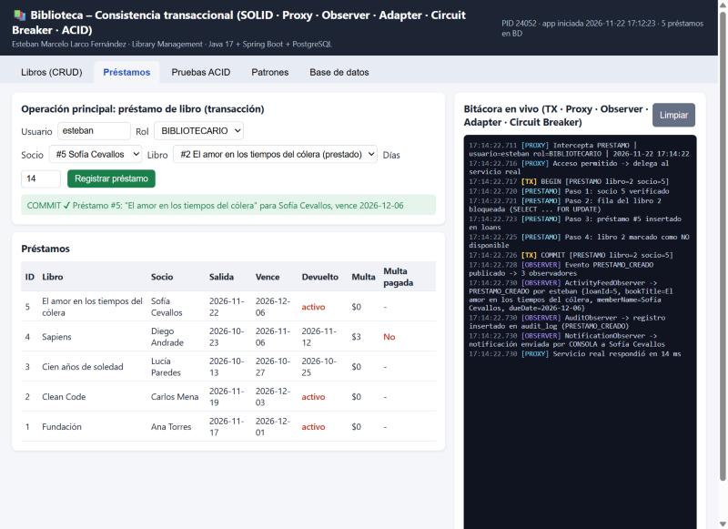
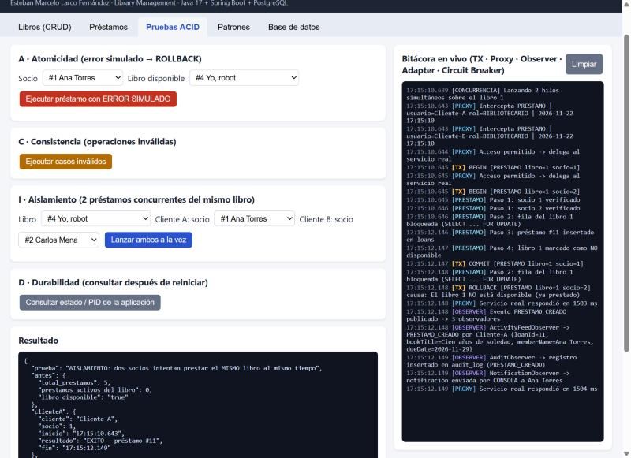
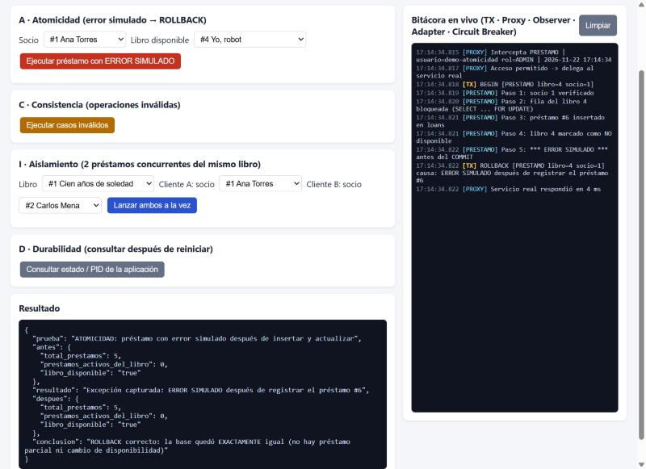
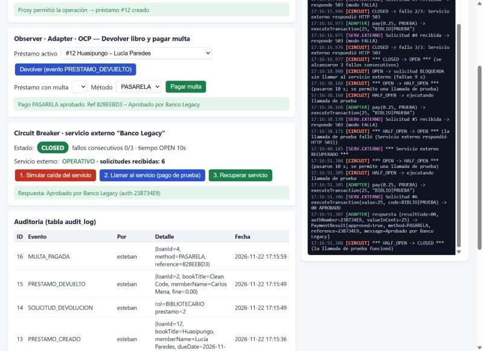

<h1 align="center">Library Loans ACID</h1>

<p align="center">
  Sistema de préstamos de biblioteca construido con <strong>Spring Boot</strong> y <strong>PostgreSQL</strong>.<br/>
  Transacciones ACID reales con JDBC, control de concurrencia con bloqueo pesimista
  y una arquitectura en capas que aplica SOLID y los patrones Proxy, Observer, Adapter y Circuit Breaker.
</p>

<p align="center">
  
  
  
  
  
  <br/>
  
  
  
  
</p>

## Descripción general

Este repositorio contiene una aplicación que gestiona los **préstamos de una biblioteca** y demuestra, con evidencia visible, cómo se construye una operación de negocio confiable. El préstamo se ejecuta en **una sola transacción de PostgreSQL**: si cualquier paso falla, se revierte todo; si dos usuarios piden el mismo libro al mismo tiempo, solo uno lo obtiene.

La interfaz web incluye una **bitácora en vivo** que muestra cada `BEGIN`, `COMMIT` y `ROLLBACK`, junto con las intervenciones del Proxy, los observadores, el Adapter y el Circuit Breaker.

## Módulos

| Módulo | Descripción |
|---|---|
| **Books** | CRUD del catálogo de libros con eliminación lógica y física |
| **Loans** | Operación principal: préstamo y devolución transaccionales |
| **Payments** | Pago de multas por efectivo, tarjeta o pasarela externa |
| **Audit** | Registro en `audit_log` de solicitudes, accesos denegados y eventos |
| **External service** | Banco legacy simulado, consumido por HTTP, con modo de falla |
| **ACID demo** | Escenarios reproducibles de atomicidad, consistencia, aislamiento y durabilidad |

## Arquitectura

- **Arquitectura en capas**: `web` → `proxy` → `service` → `transaction` / `repository` → PostgreSQL.
- **Transacciones explícitas con JDBC**: `autoCommit = false`, `COMMIT` o `ROLLBACK` controlados por `JdbcTransactionRunner`.
- **Eventos después del COMMIT**: los observadores nunca notifican una operación que luego se revirtió.



### Flujo del préstamo

```
BEGIN
 1. Verificar socio                 SELECT 1 FROM members WHERE member_id = ?
 2. Bloquear y verificar libro      SELECT availability_status FROM books ... FOR UPDATE
 3. Registrar préstamo              INSERT INTO loans ... RETURNING loan_id
 4. Cambiar disponibilidad          UPDATE books SET availability_status = FALSE
COMMIT  (cualquier error → ROLLBACK)
 → evento PRESTAMO_CREADO
```

## Propiedades ACID

| Propiedad | Cómo se garantiza | Prueba |
|---|---|---|
| **Atomicidad** | Una sola transacción JDBC; un error antes del `COMMIT` provoca `ROLLBACK` | Error simulado tras insertar y actualizar: el estado antes y después es idéntico |
| **Consistencia** | Validaciones en la aplicación + FK, `CHECK` e índice único parcial en la base | 8 operaciones inválidas rechazadas, 0 inconsistencias |
| **Aislamiento** | `READ COMMITTED` + `SELECT ... FOR UPDATE` sobre la fila del libro | Dos hilos sobre el último ejemplar: 1 éxito, 1 rechazado |
| **Durabilidad** | `COMMIT` en PostgreSQL; el arranque no reinicializa datos existentes | Reinicio con PID nuevo, mismos préstamos |

## Principios SOLID y patrones

| Concepto | Implementación |
|---|---|
| **S** — Responsabilidad única | `BookController` (HTTP), `BookService` (reglas), `PostgresBookRepository` (SQL), `JdbcTransactionRunner` (transacción) |
| **O** — Abierto/Cerrado | `FinePaymentMethod` → `CashPayment`, `CardPayment`, `ExternalGatewayPayment`; un método nuevo no modifica el servicio |
| **L** — Sustitución de Liskov | `NotificationService` → `ConsoleNotificationService`, `EmailNotificationService` |
| **I** — Segregación de interfaces | `BookQueryRepository`, `BookCommandRepository`, `BookInventoryRepository` |
| **D** — Inversión de dependencias | `LoanServiceImpl` depende solo de interfaces |
| **Proxy** | `LoanController` (cliente) → `LoanServiceProxy` → `LoanServiceImpl` (servicio real) |
| **Observer** | `LibraryEventPublisher` → `AuditObserver`, `NotificationObserver`, `ActivityFeedObserver` |
| **Adapter** | `pay(3.00, "L4")` → `executeTransaction(300, "BIBLIO\|L4")` |
| **Circuit Breaker** | 3 fallos → `OPEN`; 10 s → `HALF_OPEN`; prueba exitosa → `CLOSED` |

## Seguridad y manejo de errores

**Acceso**
- El rol se envía en las cabeceras `X-User` / `X-Role` (no hay login; es un proyecto académico).
- El Proxy permite `BIBLIOTECARIO` y `ADMIN`; bloquea `SOCIO` antes de llegar al servicio real y lo registra en `audit_log`.

**Credenciales**
- La aplicación usa un rol propio (`biblio_app`), dueño solo de `library_db`.
- La contraseña nunca está en el código: se lee de `DB_PASSWORD` o de `config/db-local.properties`, excluido por `.gitignore`.

| Respuesta | Cuándo |
|---|---|
| `400 RESTRICCION_BD` | PostgreSQL rechaza la operación (FK, `CHECK`, índice único) |
| `403 ACCESO_DENEGADO` | El Proxy bloquea un rol sin permiso |
| `409 REGLA_DE_NEGOCIO` | Socio o libro inexistente, libro no disponible, días ≤ 0 |
| `500 ERROR_SIMULADO_ROLLBACK` | Error provocado para demostrar atomicidad |
| `502 SERVICIO_EXTERNO_FALLO` | El banco externo respondió con error |
| `503 CIRCUIT_BREAKER_OPEN` | Circuito abierto: la solicitud no se envía al servicio externo |

## Stack tecnológico

| Capa | Tecnología |
|---|---|
| Backend | Java 17, Spring Boot 3.3 (Spring Web), JDBC, HikariCP |
| Base de datos | PostgreSQL 18, FK, `CHECK`, índice único parcial, `SELECT ... FOR UPDATE` |
| Frontend | HTML + JavaScript (sin frameworks), servido por Spring Boot |
| Servicio externo | Banco legacy simulado vía `java.net.http.HttpClient` |
| Build | Maven |
| Respaldo | `pg_dump` / `pg_restore` (formato Custom y SQL plano) |

## Base de datos

Basada en [Library Management Database](https://github.com/omr-ql/library_management_database) y adaptada para el proyecto.

```
authors 1──N books N──1 categories
               │
members 1──N loans            audit_log
```

**Cambios respecto al script original**: `books.active` (eliminación lógica), `loans.fine_amount` y `loans.fine_paid` (multas), `CHECK` de fechas y montos, índice único parcial `ux_loans_active_book` (un libro no puede tener dos préstamos activos) y la tabla `audit_log`.

## Estructura del repositorio

```
library-loans-acid/
├── config/                         # db-local.properties.example (plantilla de credenciales)
├── database/                       # Esquema, datos de ejemplo y respaldos (.backup / .sql)
├── docs/capturas/                  # Evidencia de ejecución
└── src/main/
    ├── java/com/larco/biblioteca/
    │   ├── web/                    # Controladores REST y manejo global de errores
    │   ├── proxy/                  # LoanServiceProxy
    │   ├── service/                # Lógica de negocio (préstamo, CRUD)
    │   ├── transaction/            # BEGIN / COMMIT / ROLLBACK
    │   ├── repository/             # Contratos (ISP) e implementación PostgreSQL
    │   ├── observer/               # Publisher y observadores
    │   ├── notification/           # Consola / email simulado
    │   ├── payment/                # Métodos de pago
    │   ├── adapter/                # Adaptador al banco legacy
    │   ├── external/               # Servicio externo simulado
    │   ├── resilience/             # Circuit Breaker
    │   └── demo/                   # Escenarios de prueba ACID
    └── resources/
        ├── static/index.html       # Interfaz web
        └── db/                     # Scripts de inicialización
```

## Puesta en marcha

Requisitos: **JDK 17+**, **Maven 3.9+** (o IntelliJ IDEA) y **PostgreSQL 14+** en `localhost:5432`.

**1. Crear el rol y la base** (una sola vez, como `postgres`):
```sql
CREATE ROLE biblio_app LOGIN PASSWORD '<contraseña>';
CREATE DATABASE library_db OWNER biblio_app;
```

**2. Configurar la contraseña**: copia `config/db-local.properties.example` como `config/db-local.properties`, o define la variable:
```powershell
$env:DB_PASSWORD="<contraseña>"
```

**3. Ejecutar**:
```powershell
mvn spring-boot:run
```
Abre `http://localhost:8080`. El primer arranque crea el esquema y los datos de ejemplo; los siguientes conservan los datos.

| Variable | Por defecto | Descripción |
|---|---|---|
| `DB_HOST` / `DB_PORT` | `localhost` / `5432` | Servidor PostgreSQL |
| `DB_NAME` | `library_db` | Base de datos |
| `DB_USER` | `biblio_app` | Rol de la aplicación |
| `DB_PASSWORD` | — | Contraseña |
| `APP_PORT` | `8080` | Puerto web |
| `NOTIFICATION_CHANNEL` | `console` | `console` o `email` |

**Restaurar el respaldo**:
```powershell
createdb -U postgres library_db
pg_restore -U postgres -d library_db database/BD_LarcoFernandezEsteban.backup
# o: psql -U postgres -d library_db -f database/BD_LarcoFernandezEsteban.sql
```

## Pruebas

Todas se ejecutan desde la interfaz web, que muestra su resultado en la bitácora.

| Prueba | Ubicación | Resultado esperado |
|---|---|---|
| Operación normal | Préstamos → Registrar préstamo | `COMMIT` |
| Error durante la operación | Pruebas ACID → Atomicidad | `ROLLBACK`; antes = después |
| Datos inválidos | Pruebas ACID → Consistencia | 8/8 rechazadas; 0 inconsistencias |
| Concurrencia | Pruebas ACID → Aislamiento | 1 éxito, 1 rechazado |
| Reinicio tras `COMMIT` | Detener, ejecutar → Durabilidad | PID nuevo, mismos datos |
| Proxy | Patrones → rol `SOCIO` | `403`; no llega al servicio real |
| Servicio externo caído | Patrones → botón 1, luego botón 2 tres veces | `CLOSED → OPEN` |
| Recuperación | Botón 3, esperar 10 s, botón 2 | `HALF_OPEN → CLOSED` |

<details>
<summary><strong>Endpoints de la API</strong></summary>

| Método | Ruta | Descripción |
|---|---|---|
| `GET` `POST` | `/api/books` | Listar / registrar libros |
| `PUT` `DELETE` | `/api/books/{id}?physical=false` | Editar / eliminar |
| `GET` `POST` | `/api/loans` | Listar / prestar |
| `POST` | `/api/loans/{id}/return` | Devolver |
| `POST` | `/api/loans/{id}/pay-fine?method=PASARELA` | Pagar multa |
| `POST` | `/api/demo/atomicity?memberId=1&bookId=4` | Prueba de atomicidad |
| `POST` | `/api/demo/consistency` | Prueba de consistencia |
| `POST` | `/api/demo/concurrency?bookId=1&memberA=1&memberB=2` | Prueba de concurrencia |
| `GET` | `/api/demo/runtime` | Estado y PID |
| `GET` `POST` | `/api/circuit`, `/api/circuit/test-call` | Circuit Breaker |
| `POST` | `/external/legacy-bank/mode?fail=true` | Simular la caída del servicio externo |

</details>

## Capturas

<p align="center">
  
  
  <br/>
  
  
</p>

## Autor

| Integrante | GitHub | Responsabilidad |
|---|---|---|
| Esteban Marcelo Larco Fernández | [@EMLarco](https://github.com/EMLarco) | Diseño, backend, base de datos y pruebas |
